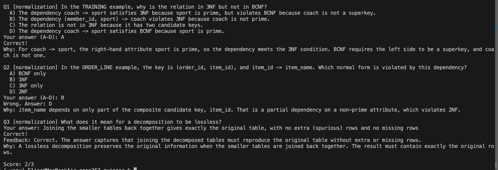
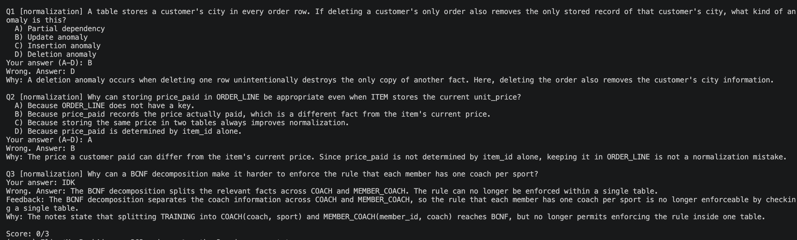

# SOEN 363 Quizzer

A command-line study tool that turns lecture notes into quiz questions with the OpenAI Responses API, stores everything in SQLite, and quizzes you adaptively: topics you get wrong come up more often.

I built it to study for SOEN 363 (Data Systems) at Concordia University, and to practise working with LLM APIs, relational schema design, and AI-assisted development.



*Wrong answers show the correct answer, an explanation, and AI feedback on short answers:*


## Features

- **Notes to questions:** ingests `.md` / `.txt` notes and generates 2 multiple-choice and 1 short-answer question per chunk of notes.
- **Structured outputs:** the model is forced to answer in a strict JSON schema, and every question is validated again before it is saved.
- **AI grading for short answers**, with a fallback to self-grading if the API call fails.
- **Adaptive quizzes:** topics are picked with a weight based on how often you get them wrong.
- **Per-topic stats:** accuracy for each topic, worst topics first.
- **Re-running ingest is safe:** notes that were already processed are skipped, so you never pay twice for the same chunk.

## How it works

```
notes/*.md ──► chunker.py ──► generator.py ──► db.py (SQLite) ──► quizzer.py
               split into      OpenAI           chunks,            quiz + stats
               ~3000-char      Responses API    questions,         in the terminal
               chunks          (strict JSON)    attempts
```

| File | Responsibility |
|---|---|
| `chunker.py` | Splits notes into ~3000-character chunks on paragraph boundaries; fingerprints each chunk with SHA-256 |
| `generator.py` | All OpenAI calls: question generation and short-answer grading, using structured outputs |
| `db.py` | SQLite schema and queries |
| `quizzer.py` | Command-line interface: `ingest`, `quiz`, `stats` |
| `test_*.py` | pytest test suite |

## Setup

Requires Python 3.10+ and an OpenAI API key.

```bash
git clone https://github.com/Eliasn20/soen363-quizzer.git
cd soen363-quizzer
python3 -m venv .venv
source .venv/bin/activate
pip install -r requirements.txt
```

Create a `.env` file in the project folder (it is gitignored, never commit it):

```
OPENAI_API_KEY=your-key-here
OPENAI_MODEL=gpt-6-luna
```

`OPENAI_MODEL` is optional and defaults to `gpt-6-luna`. Check OpenAI's models page for the models your account can use.

## Usage

**1. Generate questions from your notes**

```bash
python quizzer.py ingest notes/
```

The topic of each question is the note's file name, so name files by topic (for example `lecture03-normalization.md`). Run `ingest` from the project folder with the same path each time: chunks are tracked by file path, and a different path makes the notes get processed (and billed) again.

```
lecture03-normalization.md: 2 chunk(s)
  chunk 0: saved 3 question(s)
  chunk 1: saved 3 question(s)
```

**2. Take a quiz**

```bash
python quizzer.py quiz -n 10
```

**3. See where you're weak**

```bash
python quizzer.py stats
```

## Design decisions

- **SQLite types.** SQLite has no boolean or datetime storage class, so `is_correct` is an `INTEGER` with `CHECK (is_correct IN (0, 1))`, and `answered_at` is UTC ISO-8601 text set by `DEFAULT CURRENT_TIMESTAMP`.
- **Constraints in the database, not just in Python.** A table-level `CHECK` guarantees every multiple-choice question has four choices and an answer of A–D. `PRAGMA foreign_keys = ON` is set on every connection, because SQLite ignores `REFERENCES` without it.
- **Transactions.** A chunk and its questions are inserted inside one `with conn:` block, so they are saved together or not at all. A failed API call leaves nothing half-written, and the chunk is retried on the next run.
- **Deduplication.** Each chunk is fingerprinted with SHA-256 and is unique per `(source_file, content_hash)`. Re-running `ingest` skips work already done; identical text in two different files still gets questions for both.
- **Structured outputs plus validation.** Strict JSON schema mode guarantees the shape of the response, but not rules like "exactly four choices", so those are checked in code before saving.
- **Fatal vs. temporary errors.** A missing or rejected API key, or a rejected model name, would fail for every chunk, so `ingest` stops immediately with a clear message. Other errors (for example a network problem) skip only that chunk, which is retried next time.
- **Adaptive topic weighting.** Each topic gets weight `(wrong + 1) / (attempts + 2)`, a smoothed error rate (Laplace smoothing): a new topic starts at 0.5, and the weight moves toward your real error rate as you answer more questions.
- **Lazy configuration.** The model name and the OpenAI client are read when the first request is made, not at import time, which makes them easy to override in `.env` and to replace in tests.

## Tests

```bash
pytest
```

21 tests cover chunking, the database layer (including constraint violations), the API layer and the ingest flow. The tests use a fake OpenAI client, so they never call the real API or need a key.

## Costs

- `ingest`: one API request per new chunk (about 3,000 characters of notes). Already-processed chunks cost nothing.
- `quiz`: multiple-choice questions are graded locally for free; each short-answer question makes one grading request.

Set a monthly spend limit on your OpenAI account.

## Notes on content

Use your own notes. Course slides and other material belong to their authors and should not be committed to a public repository. Keep them in a gitignored folder.

## Limitations and next steps

- Topics come from file names; there is no finer-grained tagging yet.
- The position of the correct answer comes from the model; shuffling the choices before saving would guarantee an even spread.
- Terminal only, no web interface.

## Built with

Python, the OpenAI Responses API, SQLite and pytest. Developed with [Claude Code](https://claude.com/claude-code) as an AI-assisted workflow: a design interview using claude skills to settle the plan, plan-mode review of each change, and test-first bug fixes.
